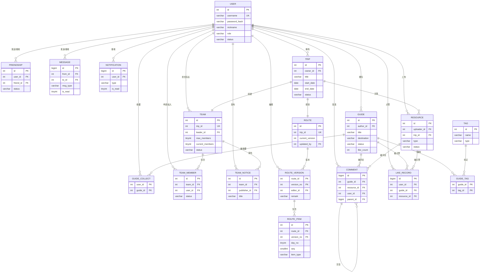

# 旅行信息分享平台 · 数据库设计（ER 与表结构）

> 课程设计：实践项目 4“集成前端、服务端及网络数据库设计开发旅行信息分享应用”
>
> 数据库：MySQL 8.0.45　字符集：utf8mb4　存储引擎：InnoDB
>
> 对应脚本：`sql/00_init.sql`、`sql/01_schema.sql`、`sql/02_views.sql`、`sql/03_procedures.sql`、`sql/04_triggers.sql`

---

## 1. 设计目标

系统围绕“旅行前—旅行中—旅行后”三条主线组织数据：

| 阶段 | 业务 | 主要表 |
| --- | --- | --- |
| 旅行前 | 攻略收集与筛选、队伍组建 | `guide`、`tag`、`guide_tag`、`guide_collect`、`trip`、`team`、`team_member` |
| 旅行中 | 路线云备份、队伍管理 | `route`、`route_version`、`route_item`、`team_notice`、`message`、`notification` |
| 旅行后 | 资源分享与浏览、好友聊天互动 | `resource`、`comment`、`like_record`、`friendship`、`message` |

设计原则：

1. **第三范式为主**：用户、攻略、行程、队伍、路线、资源分别建表，避免大宽表。
2. **关键冗余可控**：`guide`、`resource` 上的点赞/评论/收藏计数是冗余列，由触发器维护，减少列表页聚合查询。
3. **历史可追溯**：路线采用“版本表 + 条目表”，每次保存新增版本，旧版本保留，可回滚。
4. **删除策略**：用户、攻略、资源均采用状态字段软删除/隐藏，不物理删除，保留外键与历史内容。
5. **约束前移**：能用 `NOT NULL`、`UNIQUE`、`CHECK`、外键表达的规则尽量放在数据库层，应用层再做友好提示。

---

## 2. ER 图



> 说明：`COMMENT` 与 `LIKE_RECORD` 是“攻略/资源”两类目标的统一互动表，`guide_id` 与 `resource_id` 二选一，由 `CHECK` 约束保证。

---

## 3. 实体与表结构

### 3.1 用户与社交

| 表 | 作用 | 主键 | 关键约束 |
| --- | --- | --- | --- |
| `user` | 用户账号 | `id` | `username`、`email` 唯一；`role` 为 `user/admin`；`status` 为 `active/disabled` |
| `friendship` | 好友关系 | `id` | `UNIQUE(user_id, friend_id)`；`CHECK user_id <> friend_id`；`status` 为 `pending/accepted/blocked` |
| `message` | 私聊消息 | `id`（BIGINT） | `from_id`、`to_id` 外键；`idx(to_id, is_read, created_at)` 支持未读列表 |
| `notification` | 站内通知 | `id`（BIGINT） | `user_id` 外键；`idx(user_id, is_read, created_at)` |

### 3.2 攻略与互动

| 表 | 作用 | 主键 | 关键约束 |
| --- | --- | --- | --- |
| `guide` | 旅行攻略 | `id` | `author_id` 外键；`status` 为 `draft/pending/published/rejected/hidden`；`day_count` 1–60；`cost_avg >= 0` |
| `tag` | 标签字典 | `id` | `UNIQUE(name, type)`；`type` 为 `theme/season/style/other` |
| `guide_tag` | 攻略-标签 | `(guide_id, tag_id)` | 两个外键均 `ON DELETE CASCADE` |
| `guide_collect` | 攻略收藏 | `(user_id, guide_id)` | 复合主键天然防重复收藏 |
| `comment` | 统一评论 | `id`（BIGINT） | `guide_id`/`resource_id` 二选一 `CHECK`；`parent_id` 自引用；`content` 非空 |
| `like_record` | 统一点赞 | `id`（BIGINT） | `guide_id`/`resource_id` 二选一 `CHECK`；两个复合唯一键防重复点赞 |

### 3.3 行程、队伍与路线

| 表 | 作用 | 主键 | 关键约束 |
| --- | --- | --- | --- |
| `trip` | 旅行行程 | `id` | `owner_id` 外键；`CHECK end_date >= start_date`；`budget >= 0`；`status` 为 `planning/ongoing/finished` |
| `team` | 旅行队伍 | `id` | `UNIQUE(trip_id)` 实现“一行程一队伍”；`max_members` 2–50；`current_members` 1..`max_members` |
| `team_member` | 成员/入队申请 | `id` | `UNIQUE(team_id, user_id)`；`status` 为 `pending/approved/rejected/quit/removed` |
| `team_notice` | 队伍公告 | `id` | `team_id`、`publisher_id` 外键 |
| `route` | 路线主表 | `id` | `UNIQUE(trip_id)` 实现“一行程一路线”；`current_version` 指向当前版本 |
| `route_version` | 路线版本 | `(route_id, version_no)` | `version_no >= 1`；旧版本保留，支持回滚 |
| `route_item` | 路线条目 | `id` | 外键 `(route_id, version_no)`；`UNIQUE(route_id, version_no, day_no, seq)`；`day_no/seq/cost` 非负 |

### 3.4 行后资源

| 表 | 作用 | 主键 | 关键约束 |
| --- | --- | --- | --- |
| `resource` | 照片/视频/文档 | `id` | `uploader_id` 外键；`trip_id` 可空、`ON DELETE SET NULL`；`type` 为 `photo/video/doc`；`status` 为 `pending/published/rejected/hidden` |

---

## 4. 关键设计说明

### 4.1 为什么 `trip` 与 `team`、`route` 是 1:1

课程设计中的“队伍”和“路线”都依附于一次具体行程：一个行程最多组建一支队伍、规划一条路线。用 `team.trip_id`、`route.trip_id` 上的 `UNIQUE` 约束表达 1:1，比在 `trip` 里放 `team_id/route_id` 更自然，也避免循环外键。

### 4.2 路线为什么拆成三张表

- `route`：一条路线的基本信息与当前版本号。
- `route_version`：每次“保存”新增一行，记录编辑人和备注；旧版本不删除。
- `route_item`：某个版本下的具体条目，按 `day_no + seq` 排序。

保存路线时在事务中：

1. `SELECT current_version FROM route WHERE id = ? FOR UPDATE`；
2. 插入 `route_version(current_version + 1)`；
3. 批量插入 `route_item`；
4. `UPDATE route SET current_version = current_version + 1, updated_by = ?`。

`current_version` 充当乐观锁：若页面提交的版本号与数据库不一致，拒绝覆盖，提示“路线已被队友更新，请刷新”。

### 4.3 评论/点赞为什么用“双可空外键”

如果只用 `target_type + target_id`，无法建立外键，数据一致性弱；如果拆成 `guide_comment`、`resource_comment` 两张表，又会产生重复结构与重复查询。最终采用：

```sql
guide_id    INT UNSIGNED NULL,
resource_id INT UNSIGNED NULL,
CHECK (
  (guide_id IS NOT NULL AND resource_id IS NULL)
  OR (guide_id IS NULL AND resource_id IS NOT NULL)
)
```

配合两个复合唯一键：

```sql
UNIQUE KEY uk_like_guide    (user_id, guide_id),
UNIQUE KEY uk_like_resource (user_id, resource_id)
```

MySQL 的唯一索引允许多个 `NULL`，因此“攻略点赞”不会与“资源点赞”互相冲突，同时能防止同一用户对同一目标重复点赞。

### 4.4 计数冗余与触发器

`guide`、`resource` 上的 `like_count`、`comment_count`、`collect_count` 是冗余列。列表页和详情页直接读取，避免每次 `COUNT(*)`。一致性由 6 个触发器保证：

| 触发器 | 时机 | 作用 |
| --- | --- | --- |
| `trg_like_ai` / `trg_like_ad` | `like_record` 增/删 | 维护 `like_count` |
| `trg_comment_ai` / `trg_comment_ad` | `comment` 增/删 | 维护 `comment_count` |
| `trg_collect_ai` / `trg_collect_ad` | `guide_collect` 增/删 | 维护 `collect_count` |

减少计数时使用 `IF(count > 0, count - 1, 0)`，防止无符号列减到下溢。

### 4.5 软删除

- 用户：`status = 'disabled'`，不删除账号，避免历史攻略/评论作者丢失。
- 攻略：`status = 'hidden'` 或 `rejected`，不物理删除。
- 资源：`status = 'hidden'`，不物理删除。

因此 `guide.author_id`、`resource.uploader_id` 使用 `ON DELETE RESTRICT`；只有管理员在特殊情况下才考虑物理清理。

---

## 5. 视图、存储过程与触发器清单

| 对象 | 名称 | 用途 |
| --- | --- | --- |
| 视图 | `v_guide_card` | 攻略卡片：作者、标签聚合、互动计数 |
| 视图 | `v_team_card` | 队伍卡片：行程、队长、人数 |
| 视图 | `v_route_current` | 当前路线：路线 + 当前版本 + 条目数 |
| 存储过程 | `sp_search_guide` | 关键词/目的地/季节/标签筛选 + 排序 + 分页 |
| 存储过程 | `sp_review_join` | 队长审核入队申请（事务 + 行锁 + 通知） |
| 触发器 | `trg_like_ai/ad` | 点赞计数 |
| 触发器 | `trg_comment_ai/ad` | 评论计数 |
| 触发器 | `trg_collect_ai/ad` | 收藏计数 |

---

## 6. 待确认/后续

1. 当前脚本尚未在 MySQL 8.0.45 实际执行，需先初始化数据目录并启动实例，再按 `00 → 01 → 02 → 03 → 04` 顺序验证。
2. 测试账号 `alice/bob/carol/dave`（密码 `123456`）的 bcrypt 哈希需在 PHP 安装后用 `password_hash()` 生成，再写入种子数据。
3. 详细数据字典（字段级）可在数据库建好后从 `information_schema.COLUMNS` 导出，作为报告附录。
